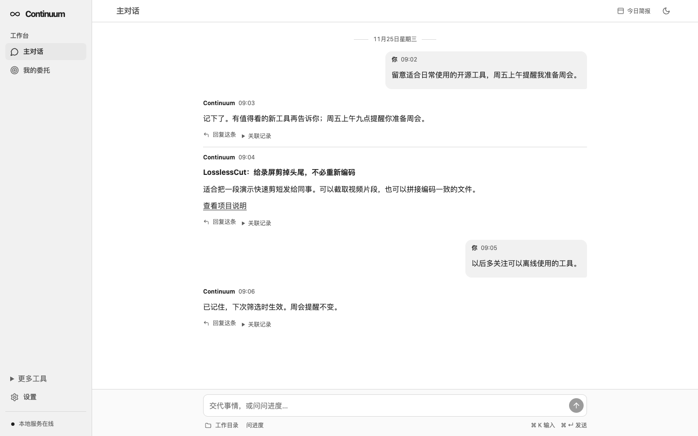
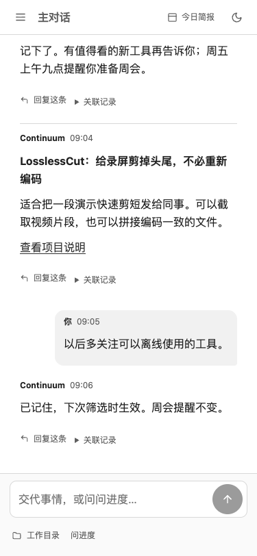

# Continuum · 本地委托工作台

在一个主对话里交代事情、询问进度、接收结果。每项委托有自己的排期和偏好；你不用打开多个聊天室，也不用盯着执行日志。

想了解一句话如何变成几项委托、每轮结果又如何回到这段对话，可以看[主会话与委托架构图](docs/architecture.md#主对话与委托)。

<picture>
  <source media="(prefers-color-scheme: dark)" srcset="design-demos/macos/workbench-dark.png">
  
</picture>

*正式界面，截图使用示例数据。* [浅色大图](design-demos/macos/workbench-desktop.png) · [深色大图](design-demos/macos/workbench-dark.png)

<details>
<summary>查看窄屏布局</summary>



</details>

## 在本机启动

已验证 macOS、Node.js 24.x（至少 24.10）、pnpm 10.4.1。

```sh
pnpm install --frozen-lockfile
pnpm db:migrate
pnpm dev
```

打开 **<http://127.0.0.1:4317/>**。首次启动默认带有无需账号的 DEMO 记录；想从空工作台开始，在首次启动前把 `.env.example` 复制为 `.env`，加入 `CONTINUUM_SEED=0`。这不会清空已有数据。已有前端构建时可直接 `pnpm start`。

需要重启时，打开「设置 → 本地服务 → 重启服务」。工作台会释放数据库后以原来的端口和数据目录重新启动，页面确认新实例就绪后自动刷新。运行中的工作可能中断；建议先在「运行监测」查看。适用于支持 Node `process.execve` 的本机启动方式，包括 macOS 的 launchd 和 `pnpm start`。

自然语言研判与真实执行需要本机 Codex CLI 和有效登录，已验证的协议基线是 `0.169.1`。在「设置 → 检查连接」核对；DEMO 不代表模型已连接。

## macOS 桌面端

在目标架构的 Mac 上安装依赖后运行 `pnpm desktop:package`，把输出的 `Continuum.app` 复制到「应用程序」，双击打开。这个本机签名的包自带 Node 和网页资源。新工作台默认使用空数据。真实执行仍需要已登录的 Codex CLI。

关闭最后一个窗口后，可以从菜单栏重新打开主对话；等待中的提醒会继续执行。「完全退出 Continuum」（⌘Q）同时停止本机服务。菜单栏的「登录时启动 Continuum」可选，登录启动时只显示菜单栏。用户手动退出后，下次打开才恢复调度。服务子进程意外退出时会重启，若一分钟内连续失败三次，会提示检查配置。

已有工作台切换前，先运行 `pnpm desktop:test`。它会打开刚构建的应用，使用临时数据检查关窗后的提醒、服务异常恢复和完全退出。正式切换前等运行中的委托结束，停用原工作台启动项，确认端口释放，备份原数据目录。可在 `~/Library/Application Support/Continuum/workbench.json` 中设置 `dataDirectory` 为原数据目录的绝对路径。若原服务使用特定的 Codex CLI，再将 `codexBinDirectory` 设为包含该命令的绝对目录。直接沿用原目录可以保留历史记录中引用的项目路径。回退时完全退出桌面端，再恢复原启动项。工作台默认监听本机 4317 端口。

## 试着交代两件事

> 帮我留意 GitHub 热榜上适合普通人用的新工具，有值得看的再说。另外，周五上午提醒我准备周会。

- 工作台在主对话里确认两项安排。「有变化再报」和「每天给我一份」是不同的承诺；读取失败不会被当成没有变化。
- 点 **问进度** 只查询记录，不重跑委托，也不会覆盖输入框里的草稿。点某条结果下的 **回复这条**，可以单独调整那项委托。
- **我的委托** 查看排期与历史，**今日简报** 阅读交付、查看待决定的事。需要追溯时再展开「关联记录」。
- 点击侧栏底部的 **运行监测** 查看正在工作、等待决定、等待排期和暂停的委托，以及工作台和子进程的 CPU、常驻内存。可从进程明细打开关联运行；仅在监测页可见时自动采样。
- `⌘K` 聚焦输入，`⌘↵` 发送。未手动指定时跟随系统明暗外观。

当前原生关注来源是 GitHub Trending 日榜；支持单次、每天、工作日的本地排期。提醒发到主对话，不是 macOS 系统通知。机器睡眠或服务关闭时不能准点执行，恢复后的补发提醒会标明原定时间。

## 在主对话里继续工作

**发送和翻历史。** 点发送后，消息立即出现在对话里，可以接着写下一条。如果消息显示「发送未确认」，在原消息上点「重试发送」，之前选的回复对象会保留。打开主对话会先看到最近的消息，向上点「查看更早的消息」可以逐页往回读。翻页或收到新回复时，正在读的旧消息会留在原处。断线重连后，页面会补上错过的消息和审批状态变化。

**指定项目。** 交代事情时提到项目名即可。每项委托分别匹配「设置 → 已授权项目」，归属不明确或首次需要授权时，工作台会在对话里询问。已经接下的委托如果因项目目录找不到而无法开始，会提醒一次。恢复原目录，或在提醒里为这项委托确认新位置，就能接着做。

**处理审批。** 同一项委托的操作审批在主对话里合成一行。点「去处理」打开待办，展开这一行可以查历史。希望后续各轮沿用授权时，在符合条件的请求上选「允许这项委托的后续操作」。对于预览有遮盖、支持本机核对的命令，先点「在本机查看完整命令」，核对后再选「按委托授权」。授权覆盖该委托在当前项目里的常规命令和文件修改（含删除）。需要额外权限时仍会询问，你也可以在委托详情撤销授权。

## 数据与执行边界

SQLite 默认在 `.local/continuum.sqlite`，API 监听本机回环地址。独立委托在专属目录的写入沙箱内运行，已有项目沿用其授权策略。运行失联时，工作台先核对上次执行到哪一步，再决定如何继续。[本机配置](.env.example)

**查看 token 用量。** 主对话输入框下方显示理解消息的用量，委托详情显示该项执行与筛选的用量，「设置」汇总工作台累计的输入、输出和总量。统计来自 Codex 上报的数据。没有用量记录的委托显示「暂无记录」，缓存和推理用量各只计入一次。

临时研判的用量来自 `codex exec --json` 的 `turn.completed.usage`。执行委托时，工作台按线程更新 `thread/tokenUsage/updated` 累计快照。要从本机会话日志生成日、月或会话报告，可以使用 [ccusage](https://ccusage.com/guide/codex/)。

## 开发与验证

```sh
pnpm harness status
pnpm lint
```

日常 PR 以 GitHub Actions 的 `lint` 为必需检查；按改动补跑 `pnpm typecheck`、`pnpm test`、`pnpm build` 或构建后的 `pnpm test:e2e`。浏览器测试使用临时数据库和 4389 端口，可设置 `CHROME_PATH`。`pnpm test:codex` 是独立的真实模型验收，需要有效登录并消耗模型配额。

工作分支推送后，用 `pnpm harness pr submit --issue N` 申请自动合并并跟到合入 **`main`**。若检查失败，在原分支修复、验证并推送，用 `pnpm harness pr watch <PR编号> --finish` 接续。合入后 harness 自动切回并同步 `main`，再清理已合并的本地分支。收尾回执和分支保留条件见 [分支清理](docs/harness.md#分支清理)。

第一次接手开发，可以从[开发交接](docs/development-handoff.md)了解一条消息如何变成委托，以及该从哪个测试开始。按需查阅[架构与恢复](docs/architecture.md)、[本机 API](docs/api.md)、[Codex 协议](docs/protocol.md)、[仓库 harness](docs/harness.md) 和[界面设计](design-demos/macos/direction-approved.md)。
