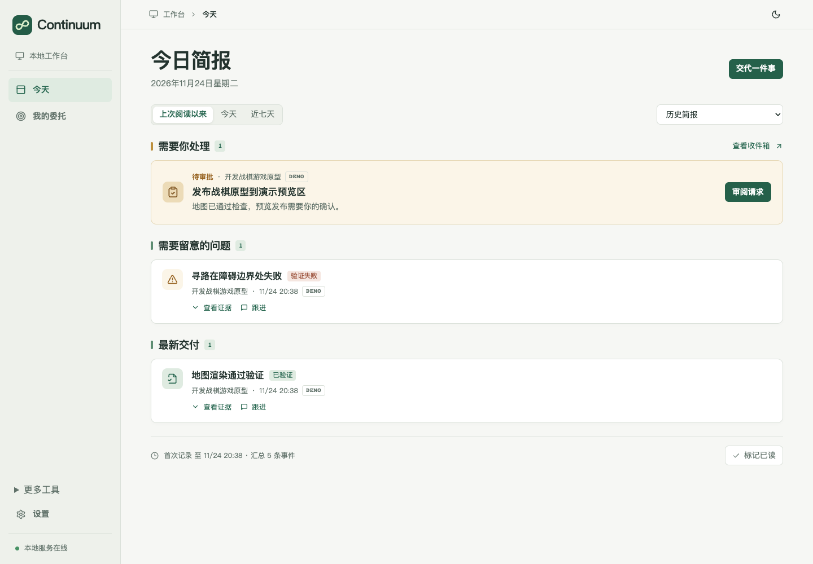

# Continuum · 本地工作台

Continuum 是一个本地委托工作台。用一句话交代想得到什么，在「今天」阅读交付；需要调整时，在原委托下修改下次要求。运行记录、来源和文件证据仍可追溯。



## 启动

已验证环境为 macOS、Node.js 24.21.0、pnpm 10.4.1。项目要求 Node.js 24.10 或更新的 24.x 版本。从本目录执行以下命令。

```sh
pnpm install
pnpm db:migrate
pnpm dev
```

打开 [本地工作台](http://127.0.0.1:4317/)。首次启动会创建「开发战棋游戏原型」的演示记录。演示无需账号。再次启动时使用原数据库。开发命令先编译网页，再启动本地服务。已经构建过的版本可使用 `pnpm start`。在运行服务的终端按 Ctrl+C 退出。

可将 `.env.example` 复制为 `.env`，修改 `PORT` 或 `CONTINUUM_DATA`。配置独立空数据目录并设置 `CONTINUUM_SEED=0` 可以从空工作台开始。数据库默认位于 `.local/continuum.sqlite`，采用 WAL。调度器与 API 共用一个进程。关闭进程后，计划任务在下次启动时检查到期情况。

## 第一次使用

1. 在今日简报查看地图渲染和寻路测试的演示结果。点击「查看证据」可以追溯到运行记录。
2. 点击「审阅请求」，核对模拟预览操作及作用范围。批准后演示会补上一条通过的寻路回归测试。拒绝会中断该轮。稍后处理会保留请求。
3. 回到简报，点击「标记已读」。没有新进展时会显示安静状态。历史简报保留生成当时的内容。
4. 在「设置」检查 Codex 连接。点「交代一件事」即可在独立目录开始真实委托；针对已有项目，可在「我的委托 → 高级创建」中选择已授权的目录。
5. 在工作目标内可继续原线程、登记验收结果、查看文件与运行记录、配置一次性或间隔计划。跟进指令保留其目标、故事或请求来源，在同一目标的当前运行结束后派发。

## 数据与运行约束

- 默认端口仅监听本机回环地址。网页与 API 同源。修改操作需携带本地会话令牌。应用不保存提供方登录凭证。
- 每次真实运行开启独立 Codex App Server 子进程。使用「交代一件事」创建专属目录时，允许在工作区写入沙箱内自行执行，不请求提权（`approvalPolicy: never`，不等于自动同意请求）。沙箱命令网络默认关闭。选择已有项目、升级前的委托及其审批记录沿用原策略。模型服务连接仍需要本机可用的账号与网络。
- 目标的暂停会阻止新运行。「中断本轮」向当前提供方发送中断请求。审批绑定当前进程、运行及原协议请求编号，每次仅答复一个请求。
- 断线后的真实任务进入「待核对」。服务读取原线程的终态，过期审批无法复用。若提供方始终无法确认，用户可在核实外部结果后登记终态及依据。
- 演示事件显式标记 DEMO。真实模式的文件存在性检查在允许的项目目录内完成。「已验证」对应具体检查，如某次测试通过或文件存在。人工点击验收框是单独的用户记录。
- 数据库保存经过筛选和脱敏的事件字段。命令的完整标准输出、标准错误、登录凭据及补丁全文日志不会作为通用活动日志保存。需要审批时会保存经脱敏的操作描述。含隐秘内容或无法完整展示的操作仅支持拒绝。文本脱敏识别常见凭据形式，无法识别所有自定义秘密格式。

## 验证

```sh
pnpm typecheck
pnpm lint
pnpm test
pnpm build
pnpm test:e2e
```

浏览器测试默认使用 macOS 已安装的 Google Chrome。其他环境可设置 `CHROME_PATH` 指向可执行文件，或使用 Playwright 安装的 Chromium。测试使用临时数据库与 4389 端口。浏览器验证会重新生成七张截图。

`pnpm test:codex` 单独执行真实模型验收，需要有效登录并消耗模型配额。它创建临时 Git 仓库，通过应用 API 新建目标，只放行该仓库指定 README 的新增补丁，检查磁盘内容、SQLite 事件、文件证据和简报，再发起同一线程的纯文字跟进。所有测试与日常数据隔离。

## 当前边界

简报使用确定性规则。可选的外部模型润色尚未接入。真实协议适配以 Codex CLI 0.169.1 为验证基线。命令审批和输入答复有协议映射，真实服务验收覆盖文件补丁审批。通用 MCP 交互、临时扩权和旧版回调会收到不支持的响应。计划触发精度受服务运行时间和本机休眠影响。工作进展按可识别的测试、文件或步骤归集，缺少来源标识的进展单独记录。

## 工程资料

- [架构与数据流](docs/architecture.md)
- [API 与实时流](docs/api.md)
- [Codex 协议与升级验证](docs/protocol.md)
- [技术决策](docs/decisions.md)
- [实施记录](docs/progress.md)
- [测试结果与七张截图](docs/test-report.md)
