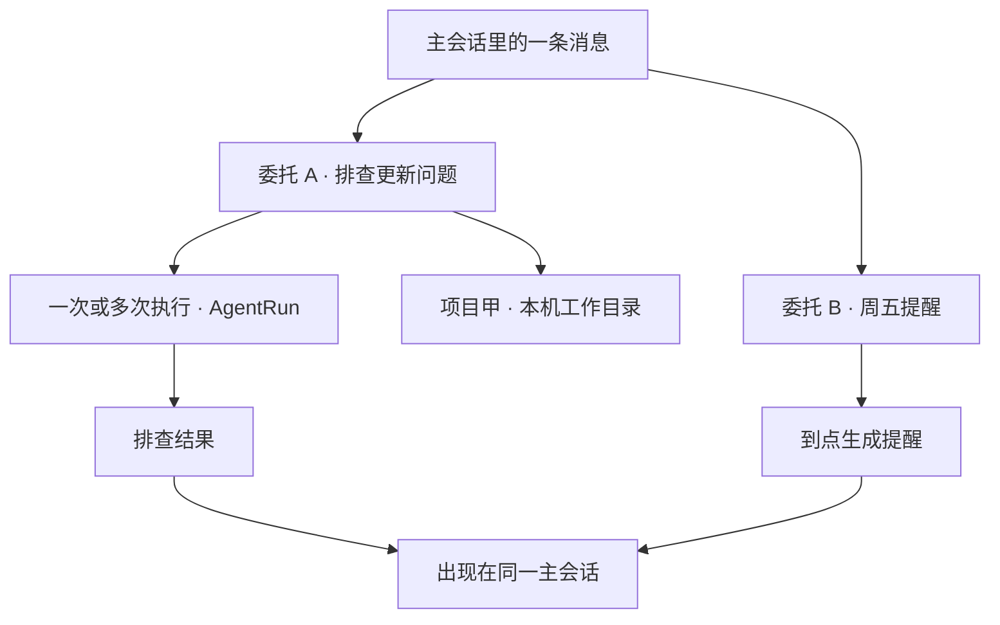

# 架构与数据流

## 主对话与委托

主会话是用户看到的唯一一条消息流。每件需要持续照看的事保存为一项委托（`Goal`），有自己的状态、要求和排期。例如，“在项目甲排查更新问题，周五提醒我准备周会”会产生两项委托。之后在排查结果下面点「回复这条」，工作台能沿着这条消息找到排查委托，周五的提醒仍按原定时间触发。

| 关系 | 在产品里意味着什么 |
| --- | --- |
| 消息与委托可以多对多（`main_refs`） | 一条交代可以涉及多项委托，一项委托也能关联多条追问、审批和交付。普通闲聊可以没有关联。 |
| 一项工作委托在一个工作目录里执行 | 多项委托可以共用已授权项目，独立工作有专属目录。选择「按委托授权」后，常规操作的许可跟随这项委托及其当前项目。更换项目或撤销授权后需重新批准。 |
| 每条 `AgentRun` 记录属于一项委托 | 重新执行会登记新的一轮，同一项委托最多有一个活跃运行。Codex 的 thread 和 turn 用来追踪执行器上下文。到点提醒可以直接交付，无需创建运行。 |

服务先根据明确的回复对象和查询内容判断归属，常见的“进度怎样了”直接读已有记录。需要模型理解时，模型提出动作，由服务核对目标和权限后写入。如果用户说“先停一下”而几项委托都可能符合，就在主会话里问清楚。同一次提交沿用唯一消息键，丢失回执后重试也只接单一次。[执行与结果回流图（HTML）](continuum-architecture.html)

实现上，`POST /api/v1/conversation/messages` 可以只提交消息键和原文。服务依次处理用户输入，在同一事务中保存这句话触发的委托变更、给用户的确认和待派发指令。`main_messages` 保存发言、回复对象与唯一来源键，`main_refs` 保存它涉及的委托。执行器接收本项工作所需的指令和偏好。[主对话实现](../apps/api/src/main-conversation.ts)

设置中的「已授权项目」保存用户登记的项目名和本机路径。主对话为每项新工作分别判断归属，服务用原话核对项目名和授权状态。独立工作使用专属目录。需要确认时，待办保存在 `main_project_questions`，用户可在问题下面选择项目或首次授权。确认和派发在同一事务内完成，其他已明确的委托可以先行。停用项目后保留队列和排期，重新启用后可继续。

已接单的工作启动前会检查项目目录。如果目录消失或指向了别处，服务把原因和一条主对话提醒一起存入 `directory_holds`，保留原指令或原定时任务。问进度时可以查到这次中断的原因。调度器发现原目录恢复后会继续派发。用户也可以在提醒中为当前委托确认新位置。两种恢复方式都沿用同一个执行键，服务重启和重复确认也只会启动原来的工作一次。已经交给执行器的任务沿用运行记录中的失败或失联核对流程。

`main-agenda.ts` 处理主对话创建的排期。机器从睡眠中恢复后，按本地日历合并错过的轮次。到点提醒直接写入主对话，普通工作经持久队列派发，GitHub 日榜采集和模型筛选各有并发上限。成功检查的来源快照和已推荐的仓库分别存入 `main_observations` 和 `main_notified`，均独立于用户已读位置。投递前复查状态、偏好与时段，结果、去重凭据和下一次排期一起提交。连续三次读取失败会提醒一次。

## 长对话如何收发和显示

浏览器发消息时先清空输入框，把原文、消息键和回复对象记入当前标签页的待发送队列，并立即显示这条消息。服务确认后，页面用同一个键把临时消息与数据库记录合并。即使服务已接单但回执在途中丢失，点击重试也会使用原键，只接单一次。[发送队列](../apps/web/src/conversation-outbox.ts)

读历史和追更新用两个不同的编号。消息的 `seq` 决定它在对话中的位置，向上翻页时读取更小的序号。变更版本 `version` 记录哪条消息的显示内容有了变化。例如，一条旧审批刚被处理，即使对话里没有新发言，它的待办数也要更新。SQLite 在同一事务中登记受影响的消息，每条只保留最近的变更版本。服务通过 SSE 通知浏览器，再由浏览器按上次收到的版本补读。正常连接且没有变化时，主对话无需定时重读消息。[数据库迁移](../migrations/014_conversation_changes.sql) · [同步接口](api.md#主对话同步)

页面先取最近一页，只有向上翻页才加载更早的历史。已经加载的消息保存在当前视图的内存里，界面只渲染屏幕附近的行。向上翻页时用正在阅读的消息定位，停在底部时才自动跟随新回复。判断用户意图时另行取上下文，包括本次输入、委托摘要、项目名称和启用状态、所回复消息的摘录，以及最多八条近期相关类型的消息，每条最多 400 字符。[历史列表](../apps/web/src/ChatHistory.tsx) · [意图判断](../apps/api/src/main-conversation.ts)

## 进程和代码位置

浏览器通过同一端口访问静态 React 页面、Fastify API 和 SSE。API 拥有一个 SQLite 写连接。调度器在同一进程内运行，额外的 SQLite 排他锁防止另一个服务同时接管该数据目录。进程退出后操作系统释放锁。

| 目录 | 职责 |
| --- | --- |
| apps/web | 主对话、我的委托、今日简报、收件箱、运行监测与设置 |
| apps/api | 路由、会话保护、运行生命周期、事务、恢复和静态网页 |
| apps/worker | 每日简报、计划任务、跟进队列、期限和未知状态核对 |
| packages/contracts | Zod 请求和响应校验 |
| packages/agent-core | 提供方接口、事件类型、状态转换与脱敏 |
| packages/demo-adapter | 固定的演示事件、等待审批与恢复 |
| packages/codex-adapter | 本机生成的类型、双向 JSONL 协议和真实进程 |
| packages/briefing | 按工作单元归集证据、评分、生成不可变快照和记录已读位置 |
| migrations | 顺序 SQL 迁移及版本记录 |

## 一轮运行如何变成简报

API 先在事务中登记运行并占用该目标的执行名额。适配器取得的真实线程和轮次编号写回运行。每次观测都按运行号和指纹去重，并取得数据库分配的全局序号。同一事务更新工作进展、版本、证据关联、文件记录及收件箱。事务提交后才通知浏览器。网络重连时以最后看到的序号重放。

事件的发生时间与本机收到时间分别保存。迟到的旧测试会留在证据集合中，避免覆盖更晚的测试结论。长期存在的目标可以跨轮次汇合同一测试或文件。代理的文字报告只标记为「代理报告」。

每份简报保存窗口、最新序号、工作进展版本、排序、生成时的文案、待处理事项及已授权计划。点击已读才推进阅读游标；打开较旧快照不会倒退游标。历史快照展开证据时按当时的截止序号查询。

## 定时执行与恢复

一次性计划和间隔计划保存下一次执行时间、租约、尝试次数和错误。先占用租约，再用「计划编号 + 原触发时间」作为本轮唯一键。重启后遇到同一键时复用已登记运行。实际派发之后发生错误时暂停该计划，避免重复执行。派发前的可恢复错误最多尝试三次。目标暂停、额度已满、处于冷却期或有活跃运行时，调度器不会开启另一轮。

演示适配器可以从持久化的待批请求恢复等待。真实进程的审批句柄随连接失效。恢复过程只查询历史并回填已完成事项，继续运行需要新一轮明确指令。
